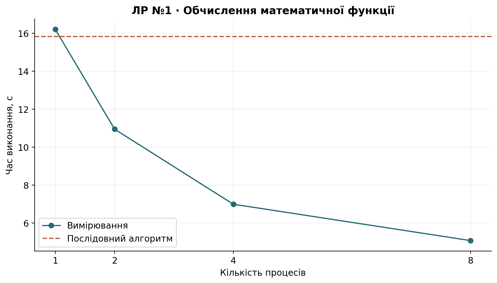
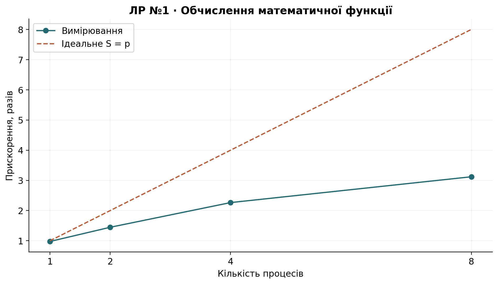
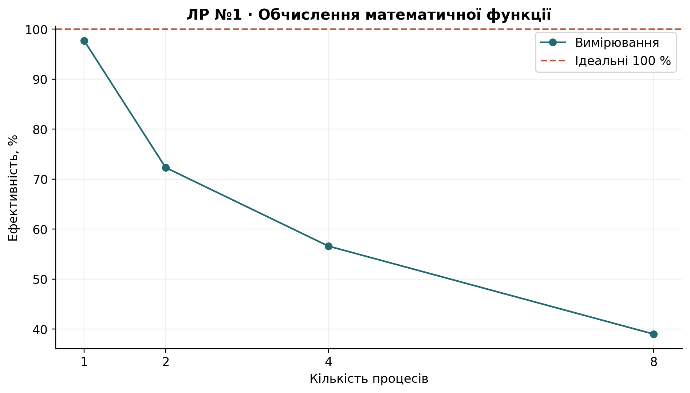

# Лабораторна робота №1

## Тема роботи

Дослідження ефективності послідовної та паралельної обробки даних у Python.

## Мета роботи

Навчитися розподіляти незалежні CPU-обчислення між процесами та оцінювати прискорення з урахуванням накладних витрат.

## Завдання

Варіант **3**: N=500 000, x∈[1; 30 000], K=200, seed=42. Для кожного елемента обчислити

$$f(x)=\sum_{i=1}^{200}\sqrt{x+i}\sin(x+i).$$

Усі значення обчислюються без кешування повторюваних x та без заміни циклу векторною операцією. Отже, кожна реалізація виконує 100 мільйонів доданків на один повний прохід.

## Теоретичні відомості

Процеси мають окремі інтерпретатори Python, тому можуть виконувати цей цикл одночасно. Ціна такого підходу — запуск інтерпретаторів, серіалізація даних та результатів, планування і синхронізація.

$$S_p=T_{seq}/T_p,\qquad E_p=S_p/p\cdot100\%.$$

У таблиці окремо подано справжній послідовний алгоритм і ProcessPoolExecutor з одним процесом. Прискорення останнього не прирівнюється до одиниці штучно.

## Хід роботи

1. **Генерація даних.** Локальний `random.Random(42)` формує 500 000 цілих чисел. Генерація вимірюється окремо й не входить у час обчислень.
2. **Послідовний алгоритм.** `process_value()` точно реалізує формулу, `sequential_processing()` обробляє масив у початковому порядку. Набір [10, 20, 30, 40, 50] наведено у `function_check.csv`; незалежний тест перевіряє формулу для K=3.
3. **Вимірювання baseline.** `perf_counter()` охоплює повний прохід без графіків та збереження файлів.
4. **Розподіл даних.** `split_data()` працює і для нерівних частин. Приклад п'яти частин збережено у `split_demo.json`. Для експерименту використано 4p задач: це дозволяє завантажити всі 8 процесів, на відміну від фіксованих п'яти задач.
5. **Паралельний алгоритм.** Функція worker доступна на рівні модуля. Контекст `spawn` і захищена точка входу сумісні з Windows. `executor.map()` зберігає порядок; результати об'єднуються саме в цьому порядку.
6. **Експеримент.** p=1, 2, 4, 8; три повні повтори кожного способу. Пул створюється заново в кожному вимірюванні. Перевірка та запис файлів відбуваються поза таймером. Порядок способів фіксований, тому фонове навантаження і нагрівання можуть впливати на розкид часу.
7. **Показники.** Speedup та Efficiency отримано з медіан. `timings_raw.csv` містить усі окремі вимірювання, `timings.csv` — медіану, мінімум і максимум.
8. **Правильність.** Для всіх 500 000 елементів у кожному повторі перевіряються довжина масиву та `math.isclose(rel_tol=1e-9, abs_tol=1e-9)`. Повний еталон збережено у `values.npy`.
9. **Візуалізація.** Графіки часу, прискорення з ідеальною лінією S=p та ефективності побудовані безпосередньо з таблиці вимірювань.

## Контрольні питання

1. **Що таке паралельна обробка даних?** Виконання незалежних частин обчислень одночасно на кількох обчислювальних ресурсах; конкурентність також допускає перекриття очікувань без одночасного CPU-виконання.
2. **Чим послідовна обробка відрізняється від паралельної?** У першій наступна частина починається після попередньої; у другій частини можуть виконуватися одночасно, після чого результати об'єднуються.
3. **Які задачі доцільно виконувати паралельно?** Великі незалежні CPU-обчислення з невеликими витратами на обмін або незалежні I/O-операції з тривалим очікуванням.
4. **Що таке CPU-bound задача?** Задача, час якої переважно визначає виконання обчислень процесором, як цикл з sqrt та sin у цій роботі.
5. **Що таке процес?** Екземпляр програми з власним адресним простором, ресурсами та щонайменше одним потоком виконання.
6. **Чим процес відрізняється від потоку?** Процеси ізолюють пам'ять, а потоки одного процесу спільно використовують її. Для потоків потрібна обережна синхронізація спільних змінюваних об'єктів.
7. **Для чого використовується ProcessPoolExecutor?** Для запуску функцій у пулі процесів через futures або map з керованим життєвим циклом і передаванням винятків.
8. **Що таке пул процесів?** Набір робочих процесів, які отримують задачі з черги та можуть виконувати кілька задач протягом свого існування.
9. **Навіщо розділяти набір даних на частини?** Щоб створити незалежні задачі, збалансувати навантаження та уникнути надмірних витрат на передавання кожного окремого елемента.
10. **Що таке Speedup?** Відношення часу послідовного алгоритму до часу досліджуваного способу. Значення менше 1 означає уповільнення.
11. **Як розраховується Speedup?** S_p=T_seq/T_p для однакових вхідних даних та меж вимірювання.
12. **Що таке Efficiency?** Частка ідеального прискорення, досягнута в середньому на одного виконавця.
13. **Як розраховується Efficiency?** E_p=S_p/p, або E_p=S_p/p×100% у відсотках.
14. **Чому реальне прискорення зазвичай менше за теоретичне?** Через послідовні ділянки, запуск, обмін, дисбаланс, конкуренцію за пам'ять і обмежені фізичні ядра. Закон Амдала задає межу 1/(s+(1-s)/p).
15. **Чому збільшення кількості процесів не завжди приводить до прискорення?** Після насичення CPU додаткові процеси збільшують перемикання контексту та обмін; кількість незалежних задач також обмежує корисний паралелізм.
16. **Що таке накладні витрати паралельного виконання?** Робота, потрібна для організації виконання: створення процесів, pickle, IPC, планування, синхронізація та збирання результатів.
17. **Який зв'язок між кількістю процесів і кількістю ядер CPU?** Для CPU-bound задач корисне p обмежене доступними ядрами. Логічні CPU не рівнозначні фізичним ядрам; оптимум встановлюють вимірюванням.
18. **Чому необхідно перевіряти однаковість результатів послідовного та паралельного алгоритмів?** Прискорення має сенс лише для еквівалентних обчислень. Перевірка виявляє втрати, дублювання, перестановки та помилки об'єднання.
19. **У яких випадках паралельна обробка може бути недоцільною?** Для малих задач, великих обсягів обміну, сильних залежностей, недостатньої пам'яті та ситуацій, де накладні витрати перевищують економію часу.


## Результати експериментів

Повний варіант №3; три повтори всіх п'яти конфігурацій. Кожен результат перевірений.

| Навантаження   | Спосіб       |   p |   Корисне p |   Медіана, с |   Мінімум, с |   Максимум, с | Перевірено   |   Повторів |   Speedup |   Efficiency, % |
|:---------------|:-------------|----:|------------:|-------------:|-------------:|--------------:|:-------------|-----------:|----------:|----------------:|
| cpu            | sequential   |   1 |           1 |      15.8377 |      15.1383 |       16.0721 | True         |          3 |    1.0000 |        100.0000 |
| cpu            | process_pool |   1 |           1 |      16.2128 |      15.7406 |       20.5487 | True         |          3 |    0.9769 |         97.6866 |
| cpu            | process_pool |   2 |           2 |      10.9493 |      10.7854 |       12.8451 | True         |          3 |    1.4465 |         72.3231 |
| cpu            | process_pool |   4 |           4 |       6.9943 |       6.3723 |        7.4338 | True         |          3 |    2.2644 |         56.6092 |
| cpu            | process_pool |   8 |           8 |       5.0766 |       4.9163 |        5.6766 | True         |          3 |    3.1197 |         38.9968 |







## Аналіз результатів

Послідовний прохід має медіану 15.8377 с. Пул з одним процесом — 16.2128 с (S=0.977), що демонструє вартість організації пулу. Найшвидший досліджений пул: p=8, 5.0766 с, S=3.120, E=39.00%. Навіть за наявності 16 логічних CPU ідеальне прискорення не гарантоване: ядра ділять ресурси, а кожен запуск передає великий масив через IPC. Розкид мінімум–максимум відображає нестабільність середовища; три повтори не є повноцінним статистичним дослідженням. Оптимум стосується цього комп'ютера, реалізації та поточного навантаження. Для цього обсягу найкращий пул прискорив обчислення.

## Висновки

Найменший час має process_pool, p=8: 5.0766 с. Правильність усіх повних запусків підтверджено; доцільність паралельності визначається співвідношенням обчислень і накладних витрат.

## Відтворення та середовище

Повний запуск: `python -m lab01.main`. Скорочений: `python -m lab01.main --quick --repeats 1`. Скорочені результати відокремлено в `results/quick/`. Окремі вимірювання: [timings_raw.csv](results/timings_raw.csv); підсумок: [timings.csv](results/timings.csv); метадані: [metadata.json](results/metadata.json).

```json
{
  "python": "3.12.6",
  "os": "Windows-11-10.0.26200-SP0",
  "logical_cpus": 16,
  "libraries": {
    "numpy": "2.1.3",
    "pandas": "2.2.3",
    "matplotlib": "3.9.2",
    "pyspark": "4.0.3",
    "nbformat": "5.11.1",
    "pytest": "9.0.3"
  }
}
```
