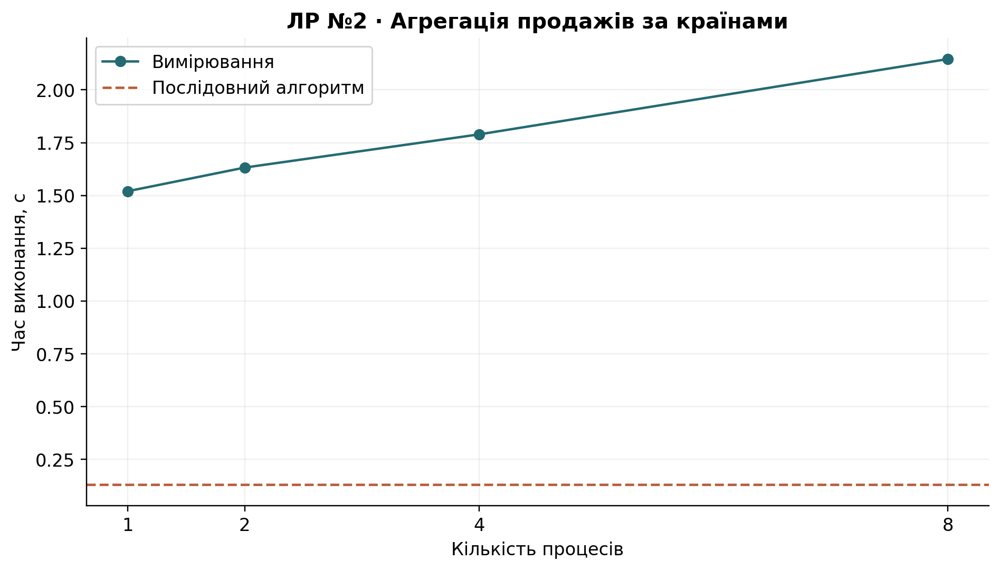
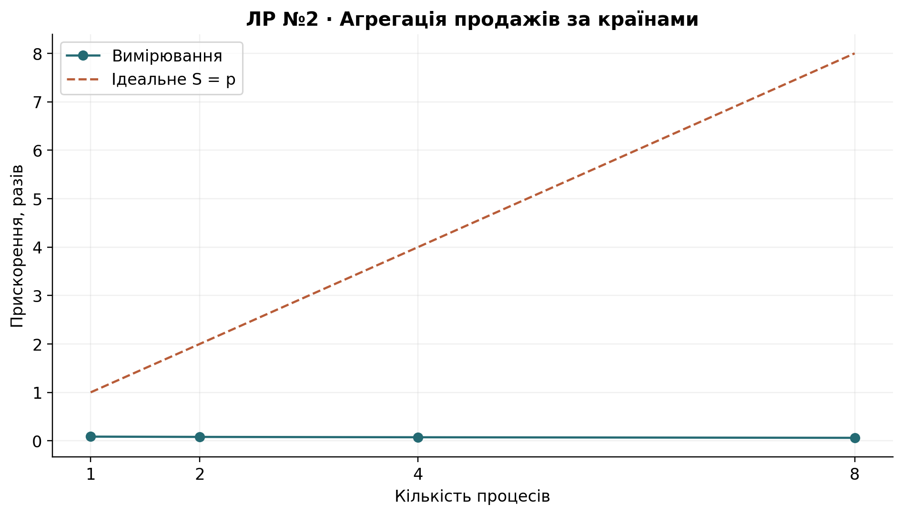
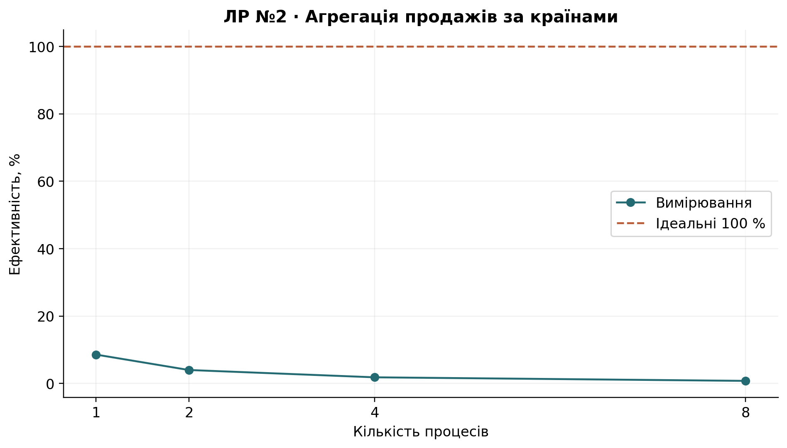
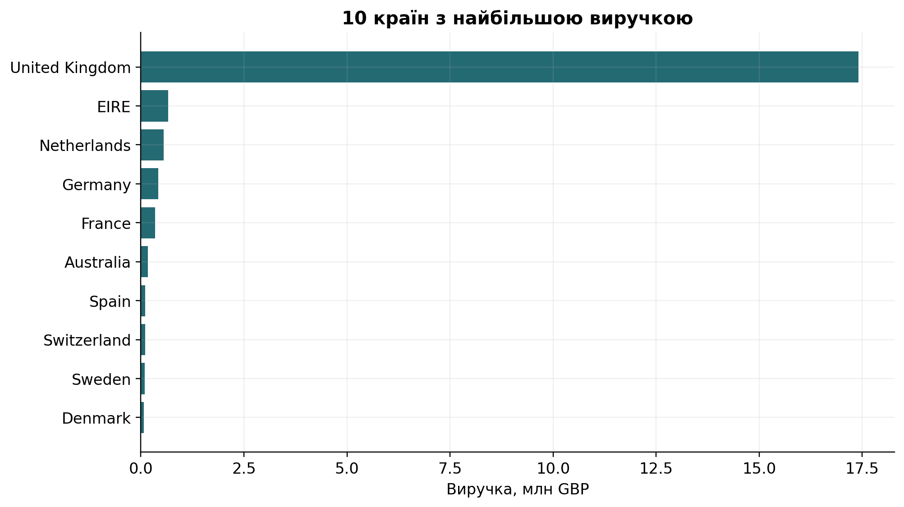

# Лабораторна робота №2

## Тема роботи

Паралельна обробка наборів даних із використанням multiprocessing.

## Мета роботи

Виконати аналіз Online Retail II, правильно об'єднати часткові агрегати та виміряти практичну доцільність багатопроцесорного підходу.

## Завдання

Виконати всі 15 завдань методички на вихідному CSV: підготувати продажі, розрахувати агрегати, групування та Top-10, порівняти послідовну обробку й пул із 1/2/4/8 процесів.

## Теоретичні відомості

`Pool.starmap()` передає кожній worker-функції DataFrame і назви стовпців. У Windows використано `spawn` та захищену точку входу.

Суми й кількості адитивні; мінімум і максимум об'єднуються відповідними операціями. Загальне середнє обчислюється як Σsum/Σcount, а середнє кожної країни — як сума виручки цієї країни, поділена на кількість її рядків. Середні частин без зважування не усереднюються.

## Хід роботи

1. **Завантаження.** Вихідний файл читається без перезапису; SHA-256 фіксує його незмінність. Визначено UTF-8, роздільник — кома. `Invoice`, `Price`, `Customer ID` перейменовано на `InvoiceNo`, `UnitPrice`, `CustomerID` лише у пам'яті.
2. **Первинний аналіз.** Кількість рядків і стовпців, вихідні типи, пропуски та точні дублікати збережено в `profile.json`. Числові описи Quantity і UnitPrice та діагностику скасувань наведено у `cleaning.json`.
3. **Підготовка.** Аналізуємо додатні продажі, а не чистий фінансовий потік із поверненнями. Послідовно виключаємо точні дублікати, скасовані рахунки (InvoiceNo починається з C без урахування регістру), обов'язкові пропуски/некоректні дати, Quantity≤0, UnitPrice≤0 та нескінченні значення. Порядок потрібен для взаємовиключних причин виключення. Окремі діагностичні лічильники до очищення можуть перетинатися.

   Точні дублікати вважаємо повторним записом тієї самої позиції. Це припущення може вилучити справжні однакові позиції; політику застосовано однаково в усіх роботах. Рядки без Description виключено. Продажі без CustomerID збережено, бо їх виручка відома; унікальні клієнти та клієнтські групування враховують лише відомі ID. InvoiceDate перетворено за явним форматом `yyyy-MM-dd HH:mm:ss`. Вихідний CSV лишається незмінним.
4. **Revenue.** Для очищених рядків розраховано `Quantity × UnitPrice`; одиниця — GBP за [описом полів Online Retail II у UCI](https://archive.ics.uci.edu/dataset/502/online%2Bretail%2Bii). Це виручка позиції рахунку, а не сума всього рахунку.
5. **Фільтрація.** Умова `Revenue > mean(Revenue)` застосована до всього очищеного набору з одним глобальним порогом. Кількість, частка та сума відфільтрованих рядків записані у `filter.json`.
6. **Групування.** Для кожної Country розраховано кількість рядків, суму та середнє Revenue. Повна таблиця — `countries.csv`.
7. **Top-10.** Сортування за спаданням суми, а за рівності — за Country. Результат — `top10.csv` та графік.
8. **Функція і baseline.** `process_chunk()` повертає count, total, mean, minimum, maximum та групи. Послідовний еталон обчислюється без пулу.
9. **Розподіл.** DataFrame ділиться на p частин з різницею розмірів не більше одного рядка. Конфігурація з чотирма процесами включена до дослідження.
10. **multiprocessing.** Новий `Pool` для кожного повтору; `starmap()` викликає функцію верхнього рівня. Передається весь очищений DataFrame, тому витрати pickle не приховані.
11. **Об'єднання.** `merge_results()` об'єднує всі частини за сумами та кількостями, включно з нерівними й порожніми частинами.
12. **Перевірка.** Для кожного запуску перевірено count, sum, mean, min, max, усі країни та Top-10, з rtol=1e-9 та atol=1e-8. Схему й ключі порівняно також.
13. **Експеримент.** p=1,2,4,8; по три повтори; медіани та окремі значення збережено. Вимірювання охоплює розбиття, створення пулу, передавання, обчислення, об'єднання та закриття пулу. Завантаження, очищення і графіки відокремлені.
14. **Графіки.** Побудовано час, Speedup, Efficiency та Top-10 на основі збережених таблиць.
15. **Оптимум.** Визначено найшвидший пул серед досліджених p та порівняно його з послідовним алгоритмом. Мінімум часу і максимум відсоткової ефективності — різні критерії.


## Результати експериментів

Вихідний набір: 1,067,371 рядків і 8 стовпців. Точних дублікатів: 34,335. Після очищення: 1,007,913; виключено 59,458.

| Причина          |   Виключено |
|:-----------------|------------:|
| exact_duplicates |       34335 |
| cancelled        |       19104 |
| missing_required |        4275 |
| invalid_quantity |         760 |
| invalid_price    |         984 |
| invalid_revenue  |           0 |

Збережено 228,488 продажів без відомого клієнта. Глобальне середнє Revenue: 20.315504 GBP; вище нього 191,092 рядків (18.959%), сума 13,540,604.95 GBP.

### Top-10 країн

| Country        |   count |         total |     mean |
|:---------------|--------:|--------------:|---------:|
| United Kingdom |  926038 | 17410196.1170 |  18.8007 |
| EIRE           |   17154 |   658767.3100 |  38.4031 |
| Netherlands    |    5085 |   554038.0900 | 108.9554 |
| Germany        |   16432 |   425019.7110 |  25.8654 |
| France         |   13639 |   350456.0900 |  25.6951 |
| Australia      |    1789 |   169283.4600 |  94.6246 |
| Spain          |    3662 |   108332.4900 |  29.5829 |
| Switzerland    |    3122 |   100685.5900 |  32.2503 |
| Sweden         |    1336 |    91869.8200 |  68.7648 |
| Denmark        |     778 |    68580.6900 |  88.1500 |

| Навантаження   | Спосіб          |   p |   Корисне p |   Медіана, с |   Мінімум, с |   Максимум, с | Перевірено   |   Повторів |   Speedup |   Efficiency, % |
|:---------------|:----------------|----:|------------:|-------------:|-------------:|--------------:|:-------------|-----------:|----------:|----------------:|
| retail         | sequential      |   1 |           1 |       0.1300 |       0.1292 |        0.1399 | True         |          3 |    1.0000 |        100.0000 |
| retail         | multiprocessing |   1 |           1 |       1.5196 |       1.5088 |        1.5557 | True         |          3 |    0.0856 |          8.5562 |
| retail         | multiprocessing |   2 |           2 |       1.6319 |       1.6222 |        1.7267 | True         |          3 |    0.0797 |          3.9839 |
| retail         | multiprocessing |   4 |           4 |       1.7891 |       1.7036 |        1.8288 | True         |          3 |    0.0727 |          1.8169 |
| retail         | multiprocessing |   8 |           8 |       2.1459 |       2.1336 |        2.1700 | True         |          3 |    0.0606 |          0.7574 |









## Аналіз результатів

Послідовне векторизоване групування: 0.1300 с. Найшвидший пул: p=1, 1.5196 с, S=0.0856, E=8.56%. Найбільша ефективність серед пулів при p=1. Жоден досліджений пул не перевершив послідовний алгоритм. Саме групування pandas реалізоване ефективними низькорівневими операціями. Запуск процесів і серіалізація понад мільйона вихідних рядків можуть коштувати більше, ніж корисні обчислення. Це пояснює відмінність від CPU-циклу в ЛР №1. Збільшення p збільшує витрати пам'яті та організації пулу. Для цього аналізу доцільний спосіб з найменшим виміряним часом; оптимум пулу не означає, що слід обов'язково обрати multiprocessing. Послідовний і паралельний алгоритми дають однакові числові результати в установленій похибці, усі групи та Top-10 збігаються.

## Висновки

Найменший час має sequential, p=1: 0.1300 с. Правильність усіх повних запусків підтверджено; доцільність паралельності визначається співвідношенням обчислень і накладних витрат.

## Відтворення та середовище

Повний запуск: `python -m lab02.main`. Скорочений: `python -m lab02.main --quick --repeats 1`. Скорочені результати відокремлено в `results/quick/`. Окремі вимірювання: [timings_raw.csv](results/timings_raw.csv); підсумок: [timings.csv](results/timings.csv); метадані: [metadata.json](results/metadata.json).

```json
{
  "python": "3.12.6",
  "os": "Windows-11-10.0.26200-SP0",
  "logical_cpus": 16,
  "libraries": {
    "numpy": "2.1.3",
    "pandas": "2.2.3",
    "matplotlib": "3.9.2",
    "pyspark": "4.0.3",
    "nbformat": "5.11.1",
    "pytest": "9.0.3"
  }
}
```
