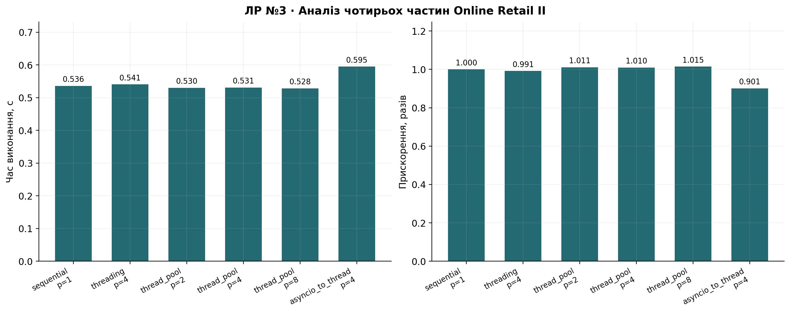
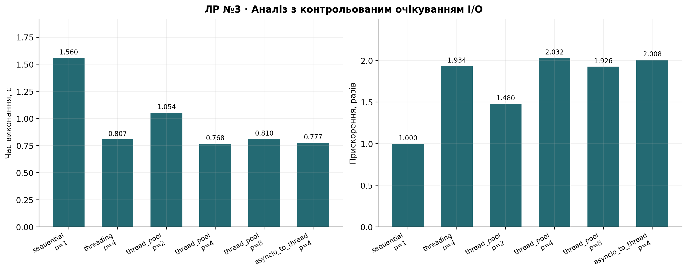
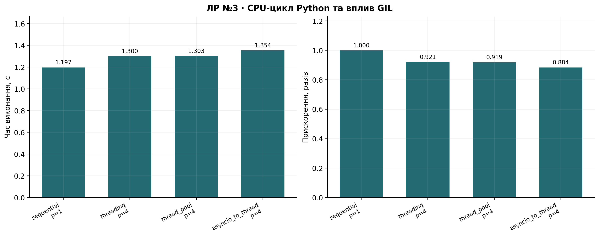

# Лабораторна робота №3

## Тема роботи

Паралельна та асинхронна обробка незалежних задач.

## Мета роботи

Порівняти послідовний аналіз, threading, ThreadPoolExecutor та asyncio на однакових чотирьох частинах Online Retail II; відокремити обчислення від очікування I/O.

## Завдання

Виконати всі 10 завдань: аналіз чотирьох частин послідовно, через Thread, ThreadPoolExecutor та asyncio; окремо дослідити I/O, прискорення й ефективність.

## Теоретичні відомості

Потоки спільно використовують пам'ять процесу. У звичайній збірці CPython GIL обмежує одночасне виконання Python-байткоду. Низькорівневі операції NumPy/pandas можуть звільняти GIL, тому їх результати не можна механічно поширювати на чисті Python-цикли.

Asyncio організовує конкурентне виконання coroutine в event loop. `asyncio.sleep()` повертає керування циклу подій, а `time.sleep()` блокує потік. `asyncio.to_thread()` переносить синхронний аналіз до thread executor: це гібрид asyncio та потоків, і його слід саме так трактувати. Asyncio самостійно не перетворює CPU-цикл на багатоядерне обчислення.

## Хід роботи

1. **Підготовка.** Використано той самий вихідний CSV, нормалізацію полів та політику очищення, що в ЛР №2. InvoiceDate — datetime, Revenue — Quantity × UnitPrice. Анонімні продажі збережено, але відсутні CustomerID не вважаються клієнтами. Первинний профіль і очищення збережені окремо.
2. **Аналіз частини.** `analyze_chunk()` повертає кількість рядків, множини товарів і відомих клієнтів, сумарний дохід, суму/кількість цін та максимум Quantity. Метод `summary()` подає шість потрібних показників, включно із середньою ціною рядка продажу.
3. **Чотири частини.** Набір ділиться на рівно чотири незалежні частини. Їх розміри та часткові статистики збережено. Дані не змінюються під час паралельного читання.
4. **Послідовний алгоритм.** Усі чотири частини обробляються одна за одною, після чого об'єднуються. Завантаження, очищення і розбиття не входять у час жодного порівнюваного способу.
5. **threading.Thread.** Створено по потоку на частину, виконано start/join. Результати та винятки повертаються через Future; після join виклики result() не дозволяють приховати помилку worker.
6. **ThreadPoolExecutor.** Окремі експерименти з 2, 4 та 8 workers. Створення й закриття executor включено в замір. Вісім workers обробляють лише чотири задачі, тому корисна конкурентність не перевищує чотирьох.
7. **Asyncio.** Реально створюються чотири `create_task()`, результати очікуються через `gather()`. Аналіз виконується через `await asyncio.to_thread()`, тому event loop не блокується синхронною функцією. Організація та завершення event loop/executor входять у вимірювання.
8. **I/O.** Для кожної частини додано однакове контрольоване очікування 0,25 с. Послідовна реалізація і потоки використовують `time.sleep()`, coroutine — `asyncio.sleep()`, а потім той самий аналіз. Це модель очікування, не вимірювання реальної мережі або диска. Усі способи повертають ті самі статистики; чотири очікування можуть перекриватися.
9. **Ефективність.** S=T_seq/T_method і E=S/p×100% розраховано окремо для навантажень `analysis`, `io`, `python_cpu`. Для asyncio p=4 одночасні незалежні задачі; для thread pool p — налаштована кількість workers. Стовпець effective_workers показує межу min(p,4), але не підміняє знаменник Efficiency. Медіани та всі повтори збережено в CSV.
10. **Порівняння.** Кожну реалізацію зіставлено з незалежним аналізом усього очищеного DataFrame. Множини об'єднано через union, середню ціну — через суму і кількість. Збігаються не тільки числа унікальних ID, а й самі множини. Окремий тест містить повторення ID між нерівними частинами.

Додаткове дослідження **GIL** використовує 40 000 значень Quantity з реального набору (по 10 000 на частину) та функцію ЛР №1 з K=200. Це окремий контрольний CPU-експеримент, який не заміняє основний аналіз усіх продажів. Для нього виміряно послідовний алгоритм, threading, ThreadPoolExecutor і asyncio.to_thread. Усі елементи результату перевірено через math.isclose. У швидкому режимі явно використовується менша підвибірка; повні результати збережено окремо.


## Результати експериментів

Статистика всього очищеного набору (унікальні клієнти — тільки відомі ID):

|        count |   unique_products |   unique_customers |       revenue |   mean_price |   max_quantity |
|-------------:|------------------:|-------------------:|--------------:|-------------:|---------------:|
| 1007913.0000 |         4916.0000 |          5878.0000 | 20476260.4480 |       4.0743 |     80995.0000 |

Чотири незалежні частини:

|       count |   unique_products |   unique_customers |      revenue |   mean_price |   max_quantity |
|------------:|------------------:|-------------------:|-------------:|-------------:|---------------:|
| 251979.0000 |         3859.0000 |          3012.0000 | 5043694.3910 |       4.4308 |     19152.0000 |
| 251978.0000 |         3565.0000 |          3346.0000 | 5214580.4530 |       4.1056 |      9360.0000 |
| 251978.0000 |         3525.0000 |          2993.0000 | 5012213.3620 |       4.0224 |     74215.0000 |
| 251978.0000 |         3340.0000 |          3214.0000 | 5205772.2420 |       3.7382 |     80995.0000 |

Очікування на задачу: 0.25 с; чистий Python CPU-контроль: 40,000 значень, K=200.

| Навантаження   | Спосіб            |   p |   Корисне p |   Медіана, с |   Мінімум, с |   Максимум, с | Перевірено   |   Повторів |   Speedup |   Efficiency, % |
|:---------------|:------------------|----:|------------:|-------------:|-------------:|--------------:|:-------------|-----------:|----------:|----------------:|
| analysis       | sequential        |   1 |           1 |       0.5360 |       0.5199 |        0.5745 | True         |          3 |    1.0000 |        100.0000 |
| analysis       | threading         |   4 |           4 |       0.5407 |       0.5400 |        0.5572 | True         |          3 |    0.9914 |         24.7846 |
| analysis       | thread_pool       |   2 |           2 |       0.5301 |       0.5268 |        0.5648 | True         |          3 |    1.0111 |         50.5554 |
| analysis       | thread_pool       |   4 |           4 |       0.5308 |       0.5299 |        0.5400 | True         |          3 |    1.0098 |         25.2451 |
| analysis       | thread_pool       |   8 |           4 |       0.5283 |       0.5172 |        0.5645 | True         |          3 |    1.0146 |         12.6823 |
| analysis       | asyncio_to_thread |   4 |           4 |       0.5951 |       0.5313 |        0.6070 | True         |          3 |    0.9007 |         22.5182 |
| io             | sequential        |   1 |           1 |       1.5599 |       1.5375 |        1.5612 | True         |          3 |    1.0000 |        100.0000 |
| io             | threading         |   4 |           4 |       0.8066 |       0.7710 |        0.8359 | True         |          3 |    1.9339 |         48.3469 |
| io             | thread_pool       |   2 |           2 |       1.0542 |       1.0420 |        1.0595 | True         |          3 |    1.4797 |         73.9839 |
| io             | thread_pool       |   4 |           4 |       0.7677 |       0.7616 |        0.8212 | True         |          3 |    2.0318 |         50.7955 |
| io             | thread_pool       |   8 |           4 |       0.8098 |       0.7640 |        0.8356 | True         |          3 |    1.9263 |         24.0788 |
| io             | asyncio_to_thread |   4 |           4 |       0.7768 |       0.7749 |        0.8001 | True         |          3 |    2.0082 |         50.2046 |
| python_cpu     | sequential        |   1 |           1 |       1.1971 |       1.1784 |        1.5232 | True         |          3 |    1.0000 |        100.0000 |
| python_cpu     | threading         |   4 |           4 |       1.2998 |       1.1672 |        1.3509 | True         |          3 |    0.9210 |         23.0244 |
| python_cpu     | thread_pool       |   4 |           4 |       1.3030 |       1.1433 |        1.4727 | True         |          3 |    0.9188 |         22.9688 |
| python_cpu     | asyncio_to_thread |   4 |           4 |       1.3544 |       1.1649 |        1.3629 | True         |          3 |    0.8838 |         22.0959 |







## Аналіз результатів

Аналіз pandas: baseline 0.5360 с; найшвидший спосіб thread_pool, p=8, 0.5283 с, S=1.015.

Аналіз із I/O: baseline 1.5599 с; найшвидший спосіб thread_pool, p=4, 0.7677 с, S=2.032.

Python CPU-цикл: baseline 1.1971 с; найшвидший спосіб sequential, p=1, 1.1971 с, S=1.000.

Для I/O перекриття очікувань дає виграш, обмежений чотирма незалежними задачами та часом самого аналізу. Вісім workers не створюють восьми задач. Python CPU-контроль показує обмеження GIL: потоки не гарантують багатоядерного прискорення Python-циклу. Pandas містить C-операції, роботу з рядками та побудову множин, тому його масштабування є змішаним і залежить від реалізації. Малі відмінності часу не слід трактувати як універсальну перевагу: вони залежать від кешів, планувальника й фонового навантаження. Asyncio у цій роботі керує очікуваннями та віддає CPU-функції потокам; джерелом CPU-паралелізму є низькорівневі операції, які звільняють GIL, а не сама наявність async def. Усі повні реалізації дали ті самі множини ID, кількості, виручку, середню ціну та максимум.

## Висновки

Для I/O найшвидший спосіб thread_pool, p=4: S=2.032. Перекриття очікувань допомагає, а CPU-обчислення потребують урахування GIL та максимуму чотирьох незалежних задач. Усі способи дали еквівалентний аналіз.

## Відтворення та середовище

Повний запуск: `python -m lab03.main`. Скорочений: `python -m lab03.main --quick --repeats 1`. Скорочені результати відокремлено в `results/quick/`. Окремі вимірювання: [timings_raw.csv](results/timings_raw.csv); підсумок: [timings.csv](results/timings.csv); метадані: [metadata.json](results/metadata.json).

```json
{
  "python": "3.12.6",
  "os": "Windows-11-10.0.26200-SP0",
  "logical_cpus": 16,
  "libraries": {
    "numpy": "2.1.3",
    "pandas": "2.2.3",
    "matplotlib": "3.9.2",
    "pyspark": "4.0.3",
    "nbformat": "5.11.1",
    "pytest": "9.0.3"
  }
}
```
