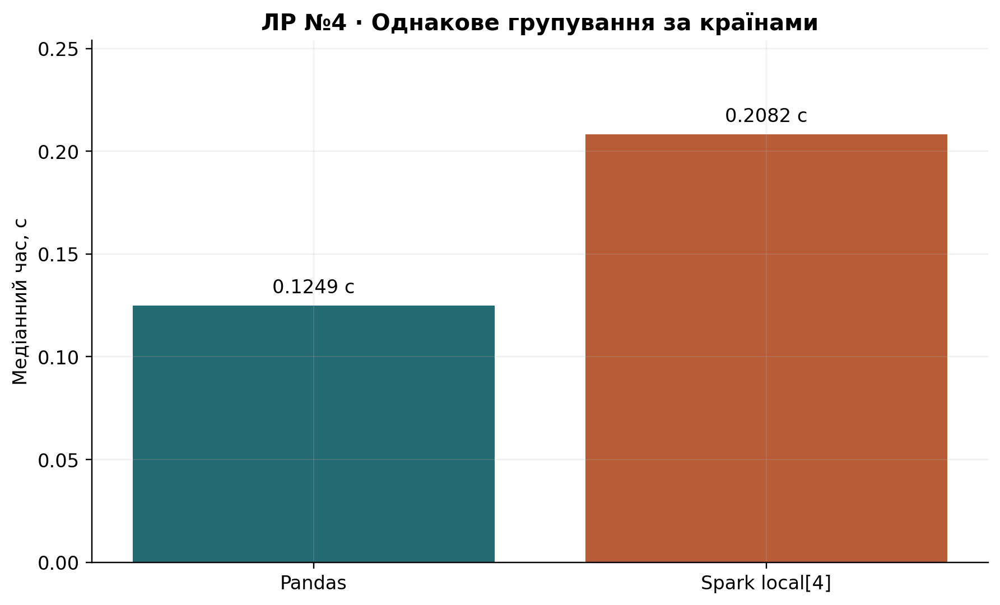
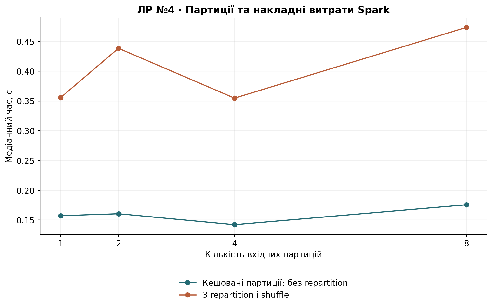

# Лабораторна робота №4

## Тема роботи

Розподілена обробка великих даних із використанням Apache Spark.

## Мета роботи

Освоїти Spark DataFrame, RDD, ліниві обчислення та розбиття даних; порівняти еквівалентний аналіз pandas і локального Spark без припущення про обов'язкове прискорення.

## Завдання

Виконати всі 10 завдань: підготувати Spark-середовище, дослідити й очистити CSV, виконати фільтрацію та три групування, RDD, lazy evaluation, порівняння pandas і експеримент із партиціями.

## Теоретичні відомості

Spark будує граф операцій. Transformation (`filter`, `select`, `groupBy/agg`, `repartition`, `RDD.map`, `RDD.filter`) описують нові дані. Action (`count`, `collect`, `reduce`) запускають виконання. `cache()` лише позначає план для збереження; потрібна action, щоб матеріалізувати кеш. `repartition()` викликає shuffle; агрегація за Country також може вимагати shuffle.

Локальний `local[4]` виконує Spark на одному комп'ютері з чотирма слотами задач. Це справжній механізм Spark, проте не багатовузловий кластер і не доказ горизонтального масштабування. Вісім партицій не створюють вісім доступних ядер. Вхідні партиції та `spark.sql.shuffle.partitions=8` — різні параметри. AQE вимкнено для контрольованого експерименту, щоб Spark не змінював кількість партицій автоматично.

## Хід роботи

1. **Середовище.** Створено SparkSession. Записано версію, master, defaultParallelism, локальні cores та конфігурацію. Java 17/21 знаходиться автоматично або задається `--java-home`; зміни JAVA_HOME та PYSPARK_PYTHON діють лише в процесі. Spark 4.0 використовує Java 17/21 ([документація Apache](https://spark.apache.org/docs/4.0.0/)).

   Початково встановлений PySpark 4.0.1 запускав JVM-операції, але Python-worker завершувався з EOFException. В офіційному трекері описано відповідну помилку Windows/Python 3.12 і виправлення у 4.0.3: [SPARK-53759](https://issues.apache.org/jira/browse/SPARK-53759). Для перевірки встановлено 4.0.3 у локальне `.venv`, без зміни глобальної інсталяції. Фактична версія записана в метаданих.
2. **Завантаження та структура.** Spark сам читає вихідний CSV з header, UTF-8, підтримкою quoted/multiline полів і FAILFAST. Початкові поля завантажено як string, щоб явно контролювати приведення типів. Підраховано рядки, пропуски та партиції. Нормалізація назв ідентична pandas.
3. **Очищення.** Spark виконує власні dropDuplicates, filter, try_cast, try_to_timestamp, withColumn. Політика така сама, як у ЛР №2: додатні продажі, виключення скасувань, точних дублікатів, обов'язкових пропусків та нечислових/нескінченних показників. Продажі без CustomerID збережено. Окремо перевірено кількість виключень кожної причини та підсумковий розмір проти pandas. Revenue формується справжньою Spark-операцією.
4. **Фільтрація та вибірка.** Застосовано глобальний поріг Revenue>mean(Revenue), вибрано InvoiceNo, StockCode, CustomerID, Country, Revenue. Кількість і сума порівняні з pandas. У файл збережено малу вибірку, а не повний DataFrame.
5. **Групування.** За товарами StockCode, відомими клієнтами CustomerID та країнами Country розраховано count, sum і mean Revenue. Всі групи та ключі порівняно з pandas, таблиці збережені в CSV. Анонімні продажі входять у групування країн/товарів і загальну виручку; відсутній ID не утворює вигаданого клієнта.
6. **Партиції.** Зафіксовано початкову та підготовлену кількість. `repartition(1/2/4/8)` змінює кількість вхідних частин; `getNumPartitions()` перевіряє матеріалізовані варіанти. Порівнювана операція однакова: groupBy(Country), count, sum, mean і collect невеликого підсумку.
7. **RDD.** Очищений DataFrame.select(Quantity, UnitPrice).rdd перетворено через map на Revenue; filter відбирає значення понад глобальне середнє; reduce(operator.add) обчислює суму. Кількість та сума перевірені незалежною Spark DataFrame-агрегацією. Використано всі очищені рядки.
8. **Lazy evaluation.** Під окремим jobGroup зафіксовано список Spark job до побудови transformation, після неї та після collect. Побудова плану не додає job; action додає їх. Збережено реальний логічний і фізичний план `query_plan.txt` та `lazy_evaluation.json`.
9. **Pandas проти Spark.** Обидва рушії незалежно очищують той самий CSV за однаковими правилами. Перед вимірюванням дані перебувають у пам'яті: pandas DataFrame та матеріалізований Spark cache. В обох випадках виконується та сама агрегація за країнами. Spark-замір включає виконання action, collect та створення малої pandas-таблиці, що забезпечує придатний до використання результат. Не включено старт JVM, читання, очищення, кешування та графіки; їх час записано окремо. Шляхи прогріті до замірів, результатна агрегація не кешується. В таблиці method=sequential означає pandas baseline.
10. **Ефективність.** Для кожних 1,2,4,8 партицій виконано три повтори двох сценаріїв. `with_repartition` включає repartition і shuffle у час. `cached_partitions` вимірює лише агрегацію на вже матеріалізованому розподілі; час його підготовки збережено в partitions_raw.csv окремо. Порівнюються медіани, а результати кожного запуску перевіряються проти всіх країн pandas з rtol=1e-9, atol=1e-8. Кількість cores весь час фіксована: експеримент змінює розбиття, а не розмір кластера.

Попередження Hadoop про відсутній winutils.exe не приховується. Для перевірених операцій читання, кешування та collect використовуються доступні Java-реалізації. Запис через Hadoop у Windows не входить у завдання: підсумкові невеликі таблиці зберігаються Python. Сторонні winutils.exe не завантажуються.


## Результати експериментів

Spark 4.0.3, local[4]; 1,067,371 вихідних і 1,007,913 очищених рядків. Початкових партицій: 1; після очищення: 8. Кількості виключених рядків Spark та pandas збіглися для кожної причини.

| Причина          |   Виключено |
|:-----------------|------------:|
| exact_duplicates |       34335 |
| cancelled        |       19104 |
| missing_required |        4275 |
| invalid_quantity |         760 |
| invalid_price    |         984 |
| invalid_revenue  |           0 |

Окремі етапи (не входять у прогріті заміри):

| Етап                          |   Час, с |
|:------------------------------|---------:|
| spark_startup_seconds         |   6.0633 |
| spark_load_seconds            |   5.5770 |
| spark_prepare_seconds         |  30.1726 |
| cache_materialization_seconds |   5.6816 |
| pandas_load_seconds           |   1.9689 |
| pandas_prepare_seconds        |   4.9557 |

### Партиції: два різні інтервали вимірювання

| scope             |   partitions |   seconds |   min_seconds |   max_seconds |   repeats | verified   |
|:------------------|-------------:|----------:|--------------:|--------------:|----------:|:-----------|
| cached_partitions |            1 |    0.1573 |        0.1398 |        0.2036 |         3 | True       |
| cached_partitions |            2 |    0.1606 |        0.1329 |        0.1641 |         3 | True       |
| cached_partitions |            4 |    0.1422 |        0.1212 |        0.1584 |         3 | True       |
| cached_partitions |            8 |    0.1757 |        0.1554 |        0.1857 |         3 | True       |
| with_repartition  |            1 |    0.3554 |        0.3492 |        0.4417 |         3 | True       |
| with_repartition  |            2 |    0.4384 |        0.4272 |        0.4628 |         3 | True       |
| with_repartition  |            4 |    0.3547 |        0.3515 |        0.3768 |         3 | True       |
| with_repartition  |            8 |    0.4735 |        0.4327 |        0.5047 |         3 | True       |

| Навантаження   | Спосіб     |   p |   Корисне p |   Медіана, с |   Мінімум, с |   Максимум, с | Перевірено   |   Повторів |   Speedup |   Efficiency, % |
|:---------------|:-----------|----:|------------:|-------------:|-------------:|--------------:|:-------------|-----------:|----------:|----------------:|
| engines        | sequential |   1 |           1 |       0.1249 |       0.1136 |        0.1303 | True         |          3 |    1.0000 |        100.0000 |
| engines        | spark      |   4 |           4 |       0.2082 |       0.2052 |        0.2447 | True         |          3 |    0.5996 |         14.9908 |





## Аналіз результатів

Еквівалентне групування: pandas 0.1249 с; Spark 0.2082 с; S=0.5996. Локальний Spark повільніший за pandas у цьому вимірюванні. Набір приблизно 95 MB вміщується в пам'ять, а групування має лише кілька десятків країн. Планування Spark job, shuffle та передавання підсумку через JVM/Python можуть переважати над обчисленнями. Це не заперечує переваг Spark для даних іншого масштабу або кластера.

cached_partitions: найменша медіана при 4 партиціях, 0.1422 с.

with_repartition: найменша медіана при 4 партиціях, 0.3547 с.

Різниця між сценаріями показує вплив перерозподілу та матеріалізації. Вимірювання з repartition починається з кешованого очищеного набору; варіант cached_partitions додатково кешує новий розподіл. Це різні межі та стани кешу, тому їх різницю не слід видавати за точну ізольовану вартість shuffle. Після певного p додаткові партиції створюють більше дрібних задач при незмінних чотирьох слотах. Вихідна кількість партицій залежить від способу читання: multiLine обробляє цей CSV як один файл. Далі dropDuplicates і groupBy використовують shuffle. Висновок стосується локального виконання, трьох повторів та зафіксованих налаштувань; оптимум може змінитися на іншій машині. Справжні Spark DataFrame і Python RDD дали еквівалентні результати; перевірені всі країни, товари та відомі клієнти.

## Висновки

Для прогрітого локального Spark S=0.5996 відносно pandas. Усі DataFrame/RDD та групування перевірені. Зміна партицій впливає на планування та shuffle; її слід оцінювати при явних межах вимірювання.

## Відтворення та середовище

Повний запуск: `python -m lab04.main`. Скорочений: `python -m lab04.main --quick --repeats 1`. Скорочені результати відокремлено в `results/quick/`. Окремі вимірювання: [timings_raw.csv](results/timings_raw.csv); підсумок: [timings.csv](results/timings.csv); метадані: [metadata.json](results/metadata.json).

```json
{
  "python": "3.12.6",
  "os": "Windows-11-10.0.26200-SP0",
  "logical_cpus": 16,
  "libraries": {
    "numpy": "2.1.3",
    "pandas": "2.2.3",
    "matplotlib": "3.9.2",
    "pyspark": "4.0.3",
    "nbformat": "5.11.1",
    "pytest": "9.0.3"
  }
}
```
